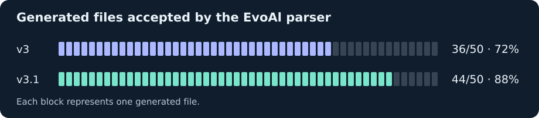

I'm a computer science master's student at the **University of Bremen**. I build AI assistants for colleagues and study how language models behave when you ask them to write code in a language they rarely see.

## At work

**IT working student · Joh. Gottfr. Schütte GmbH & Co. KG**  
Bremen, Germany · Since August 2026

I build assistants and agents for internal use in **Microsoft Copilot Studio**. I use **Power Apps** to turn manual processes into internal tools and **Power Automate** to connect the steps people would otherwise repeat by hand.

## Selected projects

### [Parliamentary Protocol AI ↗](https://github.com/uyar1/parliamentary-protocol-ai)

From a recording of a Bremen Parliament session to a transcript and a summary by topic. I worked on the backend that connects WhisperX transcription with multi-stage summarization.

`Python` · `FastAPI` · `WhisperX` · `Docker`

### [Document Q&A ↗](https://github.com/uyar1/document-qa-rag)

Upload a PDF and ask it a question. The app searches for relevant passages in ChromaDB and sends them to Claude as context for the answer. I deployed the containerized service on AWS.

`FastAPI` · `ChromaDB` · `Claude` · `AWS`

## Research · Can a small model learn EvoAl?

*Bachelor's thesis · University of Bremen · July 2026*

I fine-tuned **Qwen3-4B** with LoRA on an **RTX 4060 with 8 GB of VRAM**. To teach it EvoAl, a family of domain-specific languages, I built 7,500 training examples from grammars and sample files. Correcting a recurring error in the training data improved the model's parser results.

**Would the generated code run?** All three end-to-end workflow tests failed. One exposed a syntax error. In the other two, the model reproduced training examples instead of following the request.

I also studied computer science and operations research at **Boğaziçi University** in Istanbul during an Erasmus+ semester.
